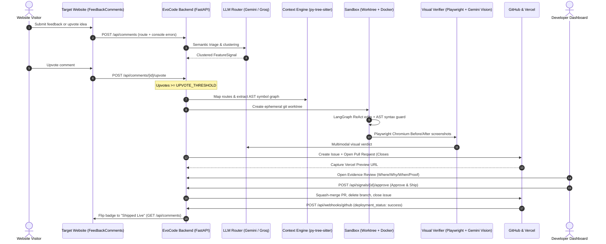

# EvoCode V2 🤖🚀

<div align="center">

**100% Autonomous, Visually Verified Pull Request Platform with One-Click Production Deployment**

*From user comment upvotes to verified, production-deployed GitHub PRs — at $0/month.*

[](https://www.python.org/)
[](https://fastapi.tiangolo.com/)
[](https://nextjs.org/)
[](https://aistudio.google.com/)
[](https://groq.com/)
[](https://playwright.dev/)
[](https://tree-sitter.github.io/)
[](./LICENSE)

</div>

---

## 🌟 What is EvoCode V2?

**EvoCode V2** transforms static software development by closing the feedback loop between website visitors and production releases. 

1. **Community Comments & Silent Telemetry:** Visitors submit feature requests or report bugs via the embedded `FeedbackComments` widget on the target website. The widget automatically attaches page route telemetry and trapped browser console errors.
2. **Semantic Clustering & 3-Tier Free LLM Router:** Similar user requests are clustered semantically into a single `FeatureSignal` using Groq / Gemini 3.8 Flash. Vague comments receive an instant 1-line AI clarification reply.
3. **Threshold Gate & Ephemeral Worktree Sandbox:** The moment upvotes hit `UPVOTE_THRESHOLD`, EvoCode spins up an isolated `git worktree` and container sandbox.
4. **`py-tree-sitter` AST Context & Syntax Guard:** LangGraph surgical edits (`replace_in_file`) undergo instant post-edit AST syntax checks. If a syntax error is introduced, it is rolled back before tests run.
5. **Multi-Modal Visual Verification:** An ephemeral test server boots up; **Playwright** captures console errors and Before/After screenshots (`1280x800`). Multimodal **Gemini 3.8 Flash** evaluates visual correctness with up to 3 self-healing retries.
6. **One-Click Auto-Ship & Production Webhook:** The developer inspects Where/Why/When/Proof on the Evidence Review dashboard. A single click on **Approve & Ship** squash-merges the PR, auto-closes the GitHub issue (`Closes #X`), deletes the feature branch, and triggers Vercel production deployment — flipping the target site's comment badge to **Shipped Live** via verified GitHub webhook.

---

## 🏗️ Master Architecture



---

## 🧠 State Machine & Dual-Mode Autonomy Guardrails

```
gathering_votes ──(threshold reached)──► queued ──► planning ──► coding ──► verifying
                                                                                │
                   ┌────────────────────────────────────────────────────────────┴──────────┐
                   ▼                                                                       ▼
      [Confidence Score >= 70]                                                [Confidence Score < 70]
         Autonomous PR-First                                                   Assist Mode (Safety Net)
                   │                                                                       │
                   ▼                                                                       ▼
             pr_ready                                                             assist_mode_blocked
                   │                                                                       │
      ┌────────────┴────────────┐                                                          │
      ▼                         ▼                                                          │
Approve & Ship               Reject                                                        │
      │                         │                                                          │
      ▼                         ▼                                                          │
approved_shipped             rejected                                           Manual IDE Strategy Guide
      │                                                                         (Auto-merge locked)
      ▼
Shipped Live Badge
```

| Confidence Score | Mode | Automated Actions | Human Gate |
| :--- | :--- | :--- | :--- |
| **`>= 70`** | **Autonomous PR-First** | Issue opened → Code edited in worktree → Tests + Playwright visual verified → PR ready with Vercel Preview URL | End-of-day 1-click **Approve & Ship** |
| **`< 70`** | **Assist Mode** | Issue opened → `PLAN.md` + Strategy Guide generated → Auto-merge locked | Developer reviews guide and executes manual changes |

---

## 💸 Verified 2026 Zero-Cost Tech Stack ($0/Month)

| Layer | Component | Verified Free Tier | Role in EvoCode V2 |
| :--- | :--- | :--- | :--- |
| **Primary Brain** | Google Gemini 3.8 Flash | Free standard I/O + context caching | Planner, LangGraph Code Agent, Multimodal Visual Judge |
| **Fast Triage & Failover** | Groq & OpenRouter `:free` | Groq: 30 RPM / 30K TPM (Llama 3.1 8B / 3.3 70B); OpenRouter: 20 RPM | Low-latency comment deduplication, vagueness checks, 429 failover |
| **Context & Syntax Guard** | `py-tree-sitter` | 100% Free, local, zero-latency | AST symbol extraction, Next.js route mapping, post-edit syntax verification |
| **Sandbox Isolation** | Ephemeral `git worktree` + Docker | Local daemon / non-root subprocess | Zero-pollution workspace isolation with clean `finally` teardown |
| **Visual Verification** | Headless Playwright Chromium | 100% Free (Apache-2.0) | Traps browser errors, captures 1280x800 Before/After screenshots |
| **Live Previews & CD** | Vercel Hobby + GitHub API | 100 deploys/day, automatic PR previews | Live HTTPS preview per PR branch; production deployment on merge |
| **Database & Stream** | SQLAlchemy (SQLite / Supabase Postgres) | Free SQLite local / 500 MB Postgres | Event audit trail, comment clusters, real-time SSE telemetry |

---

## 📂 Repository Structure

```text
evo-code/
├── README.md                                # Master documentation & architecture
├── evocode.db                               # Local SQLite database
└── evocode-v1/
    ├── backend/
    │   ├── main.py                          # FastAPI REST, SSE streams, Webhook & Approval routes
    │   ├── models.py                        # FeatureSignal, Comment, Upvote, AuditEvent, FixAttempt
    │   ├── database.py                      # Multi-DB engine (SQLite + Supabase PostgreSQL)
    │   ├── llm_router.py                    # Multi-provider free failover (Gemini -> Groq -> OpenRouter)
    │   ├── signal_triage.py                 # Semantic clustering, vagueness reply, upvote engine
    │   ├── context_engine.py                # py-tree-sitter AST symbol extractor & route mapper
    │   ├── visual_verifier.py               # Playwright Chromium capture + Gemini Vision Judge
    │   ├── test_phase5_autoship.py          # Phase 5 verification test suite (9 tests)
    │   ├── test_complete_flow.py            # End-to-end sandbox execution pipeline test
    │   └── utils/
    │       ├── github_manager.py            # Squash merge, branch deletion, issue closure, preview polling
    │       ├── sandbox_runner.py            # Ephemeral git worktree runner with Docker & subprocess fallback
    │       ├── langchain_tools.py           # Surgical replace_in_file with AST rollback
    │       ├── code_agent_with_tools.py     # Multi-tool LangGraph coding agent
    │       └── agent_orchestrator.py        # Pipeline coordinator
    ├── frontend/
    │   ├── app/
    │   │   ├── components/
    │   │   │   ├── TriageDashboard.tsx      # Live signals dashboard (zero mock data)
    │   │   │   ├── EvidenceReview.tsx       # 4-quadrant review (Where / Why / When / Proof)
    │   │   │   ├── AssistModePanel.tsx      # Strategy guide & locked auto-merge (< 70)
    │   │   │   ├── LiveTerminal.tsx         # Real-time SSE execution log terminal
    │   │   │   └── FeedbackComments.tsx     # Embedded comments widget with "Shipped Live" badge
    │   │   └── developer/build/[id]/page.tsx# Signal build details + One-Click Approve & Ship Gate
    │   └── package.json
    └── test-target/                         # Local target app for sandbox testing
```

---

## 🔌 API & Webhook Reference

| Method | Endpoint | Description |
| :--- | :--- | :--- |
| `POST` | `/api/comments` | Submit user feedback with route and browser console telemetry |
| `POST` | `/api/comments/{id}/upvote` | Upvote a comment/signal; triggers build when reaching threshold |
| `GET` | `/api/comments?route=/...` | Fetch comments for a route with live **"Shipped Live"** status and PR URLs |
| `GET` | `/api/signals` | List all clustered `FeatureSignal` items (replaces static ticket mocks) |
| `GET` | `/api/signals/{id}` | Retrieve full signal details (diff, comments, audit events, screenshots) |
| `GET` | `/api/signals/{id}/stream` | Server-Sent Events (SSE) streaming live agent actions to `LiveTerminal` |
| `POST` | `/api/signals/{id}/approve` | **One-Click Auto-Ship:** Squash-merges PR, closes GitHub issue, deletes branch |
| `POST` | `/api/signals/{id}/reject` | Closes PR, deletes branch, and marks signal rejected |
| `POST` | `/api/signals/{id}/retry` | Accepts edited plan markdown and re-queues agent execution |
| `POST` | `/api/webhooks/github` | HMAC-SHA256 verified webhook listening for Vercel/GitHub deployment success |

---

## ⚡ Quick Start

### 1. Environment Configuration

Create `evocode-v1/backend/.env`:

```env
# Database
DATABASE_URL=sqlite:///./evocode.db

# Target Repository
REPO_PATH=C:\Users\username\Desktop\evocode-test-target
GITHUB_TOKEN=ghp_your_github_token_here
REPO_OWNER=your_github_user
REPO_NAME=evocode-test-target
GITHUB_WEBHOOK_SECRET=your_webhook_secret_here

# AI Multi-Provider Free Keys
GEMINI_API_KEY=your_gemini_api_key
GEMINI_PRIMARY_MODEL=gemini-3.8-flash
GROQ_API_KEY=your_groq_api_key
OPENROUTER_API_KEY=your_openrouter_api_key

# Autonomy & Verification Controls
UPVOTE_THRESHOLD=1
CONFIDENCE_AUTO_THRESHOLD=70
EXECUTION_MODE=autonomous_pr
SANDBOX_BACKEND=auto
TEST_TIMEOUT=30
MAX_FIX_RETRIES=3
ENABLE_VISUAL_VERIFIER=true
```

### 2. Start Backend

```bash
cd evocode-v1/backend
pip install -r requirements.txt
uvicorn main:app --reload --port 8000
```

### 3. Start Frontend Dashboard

```bash
cd evocode-v1/frontend
npm install
npm run dev
```
Open **`http://localhost:3000`** (or configured port) to access the live dashboard.

---

## 🧪 Verification Tests

Run the full Phase 5 verification test suite:

```bash
python -m pytest -s evocode-v1/backend/test_phase5_autoship.py
```

Test coverage includes:
- Confidence score guardrails (auto-merge blocked below 70 without override)
- High-confidence 1-click **Approve & Ship** execution
- Pull Request rejection and branch cleanup
- GitHub Webhook HMAC-SHA256 signature verification & ping handshake
- Production `deployment_status` success handling
- Live comment **"Shipped Live"** badge rendering and PR linking
- `FeedbackComments.tsx` telemetry and upvote handlers

---

<div align="center">
  Built with ❤️ for autonomous, zero-cost developer workflows.
</div>
