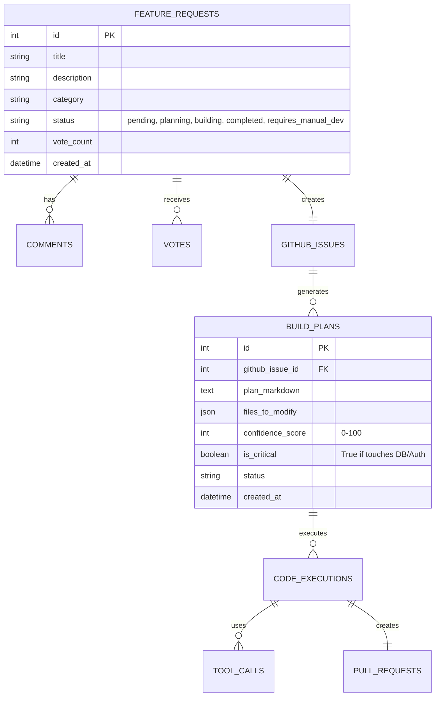
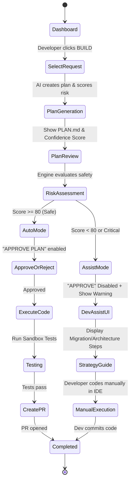
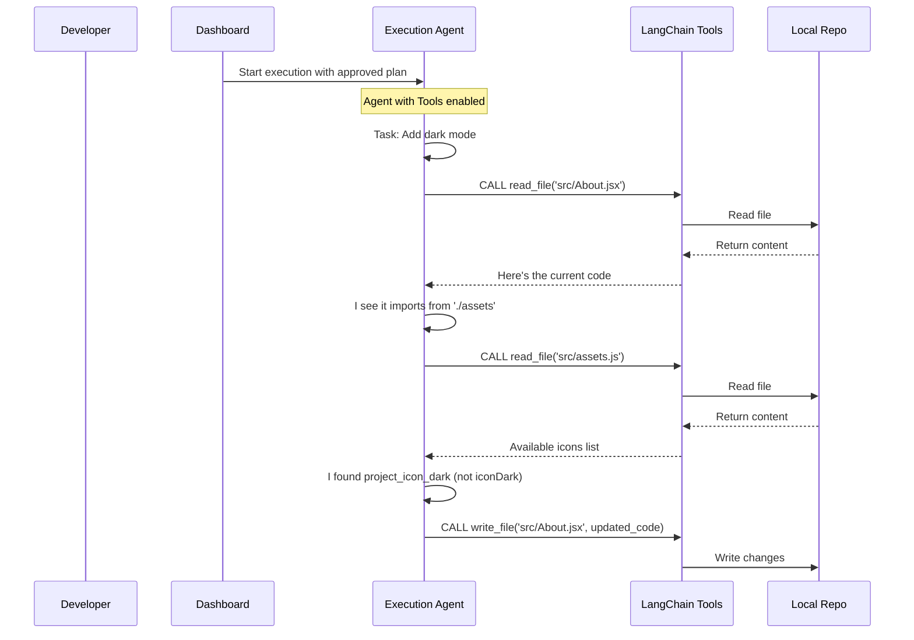

# 🎯 EVOCODE V2: AGENTIC DEVELOPER DASHBOARD
**Complete Hackathon Architecture & Battle Plan**

## 🔥 EXECUTIVE SUMMARY
EvoCode V2 bridges the gap between client feedback and production code by combining an AI Product Manager with an AI Software Engineer. Instead of replacing the developer, EvoCode eliminates the project management bottleneck while keeping the Lead Engineer in total control.

**The Core Innovations:**
1. **Dynamic Guardrails (Assist Mode):** EvoCode evaluates feature requests and assigns a Confidence Score. Low-risk UI tasks are fully automated end-to-end. High-risk architectural changes (like DB migrations) trigger "Assist Mode," halting automated execution and generating an Architectural Strategy Guide for the Lead Developer, ensuring zero-trust enterprise security.
2. **Feedback Aggregation:** Users upvote feature requests (like Reddit/ProductHunt).
3. **Developer Dashboard:** Devs see trending requests and click "Build".
4. **AI Planning Agent:** Generates GitHub issues + implementation plans.
5. **AI Coder Agent with Tools:** Reads codebase files natively to avoid hallucinations.
6. **Autonomous Execution:** Runs sandbox tests and creates Pull Requests automatically.

---

## 📊 CORE ARCHITECTURE DIAGRAMS

### Diagram 1: Database Schema

### Diagram 2: Developer Dashboard UI & Guardrail Flow

### Diagram 3: AI Agent Tool Flow (Solving Hallucinations)
